<p align="center">
  <picture>
    <source media="(prefers-color-scheme: dark)" srcset="assets/header-dark.svg">
    <source media="(prefers-color-scheme: light)" srcset="assets/header-light.svg">
    
  </picture>
</p>

<p align="center">
  <a href="https://your-clipvault-url"><b>Open ClipVault</b></a>
  &nbsp;·&nbsp;
  <a href="#how-it-works">How it works</a>
  &nbsp;·&nbsp;
  <a href="#private-from-end-to-end">Private chat</a>
  &nbsp;·&nbsp;
  <a href="#getting-started">Get started</a>
</p>

<p align="center">
  
  
  
  
</p>

<br>

## A simple online clipboard for your snippets

Save text, images, and PDFs. Open your vault on any device with a short code. No account, no sign-up, no password to remember.

<br>

## How it works

| | |
|---|---|
| **1. Get your code** | Tap *Get my code* and you get a vault code like `AAA-000`. |
| **2. Save anything** | Drop in snippets of text, images, or PDFs. Search them and copy with one tap. |
| **3. Open it anywhere** | Enter the same code on any device to open the same vault. Tick *Remember me on this device* to skip it next time. |

> [!NOTE]
> Anyone with your code can open your vault, so keep it private and don't store passwords or other sensitive information in it.

When your browser has loaded the app and opened a vault, the app shell and up to 24 recent vault responses are cached on that device. Previously opened snippets can be read offline; creating, editing, chat, and Google Drive actions require a connection.

<br>

## Made for everyday sharing

<table>
  <tr>
    <td width="50%" valign="top">
      <h3>01 &nbsp;Google Drive attachments</h3>
      Connect your own Google Drive to attach images and PDFs. ClipVault saves them in its own Drive folder and only manages files it created.
    </td>
    <td width="50%" valign="top">
      <h3>02 &nbsp;Open your vault with a code</h3>
      Use the same vault code on another device without creating an account.
    </td>
  </tr>
  <tr>
    <td width="50%" valign="top">
      <h3>03 &nbsp;Private, end-to-end chat</h3>
      Messages are encrypted in your browser before upload. The server stores ciphertext and message metadata. Both people must set up chat and accept the request.
    </td>
    <td width="50%" valign="top">
      <h3>04 &nbsp;Save and reuse snippets</h3>
      Keep small pieces of text, search your vault, and copy them when you need them.
    </td>
  </tr>
</table>

<br>

## Private from end to end

<p align="center">
  <picture>
    <source media="(prefers-color-scheme: dark)" srcset="assets/flow-dark.svg">
    <source media="(prefers-color-scheme: light)" srcset="assets/flow-light.svg">
    
  </picture>
</p>

A message is encrypted on one device, relayed unreadable by the server, and opened only by its recipient.

1. **Write a message.** It's readable text on the sender's own device.
2. **Encrypt on device.** The message is locked with a key before it leaves the browser.
3. **Relay.** The server only handles ciphertext and metadata.
4. **Open.** Only the recipient's key can unlock it.

<br>

## Privacy

- Images and PDFs stay in **your** Google Drive. ClipVault only accesses files it created.
- Chat messages are encrypted in the browser before upload.
- Vaults are opened with a code, not an account.

See the in-app Privacy Policy and Terms of Service for details.

<br>

## Getting started

```bash
git clone https://github.com/your-username/clipvault.git
cd clipvault
npm install
npm run dev
```

Then open the local URL printed in your terminal.

<!-- Add environment variables here if your app needs them, e.g. a Google OAuth client ID for Drive attachments. -->

<br>

## Built with

<p>
  
  
  
  
</p>

<br>

## Contributing

Issues and pull requests are welcome. For larger changes, open an issue first so we can talk it through.

## License

[MIT](LICENSE)

<br>

<p align="center">
  <sub>Built by Shubham</sub>
</p>
